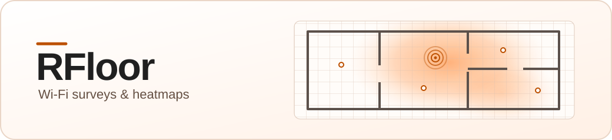

<p align="center">
  
</p>

<p align="center">
  <a href="https://github.com/BlackF1re/RFloor/actions/workflows/build.yml"></a>
</p>

# RFloor

**Indoor Wi-Fi surveys on your own floor plans.** Draw a plan, collect measurements as you walk through the space, and inspect the results as heatmaps. The plan and its measurements share a single `.rfplan` file.

## At a glance

| Area | What you can do |
| --- | --- |
| **Plan** | Draw rooms to scale, add walls and openings, and mark furniture and access points. |
| **Survey** | Collect signal strength, ping, and iperf3 upload and download at each point. Keep readings from different frequency bands at the same location. |
| **Heatmaps** | Switch between signal, throughput, and latency layers. Estimates use nearby readings for the selected band and access point and account for walls. |

## Download

**[Latest release →](https://github.com/BlackF1re/RFloor/releases/latest)**

| Platform | How to start |
| --- | --- |
| **Windows** | Run the installer or extract the portable ZIP and open `RFloor.Desktop.exe`. |
| **Linux** | Extract the `.tar.gz` archive and open `AppRun`. |
| **Android** | Install the `.apk` and allow Wi-Fi access when prompted. |

## Build & documentation

RFloor uses C#, .NET 10, and Avalonia. Run the shared checks from the repository root.

```sh
dotnet run --project tests/RFloor.Checks -c Release
```

**[Build & test →](docs/BUILD.md)** · [Project format](docs/FORMAT.md) · [Sample plan](examples/)
